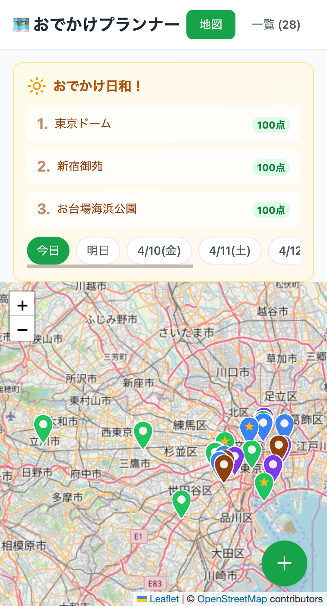
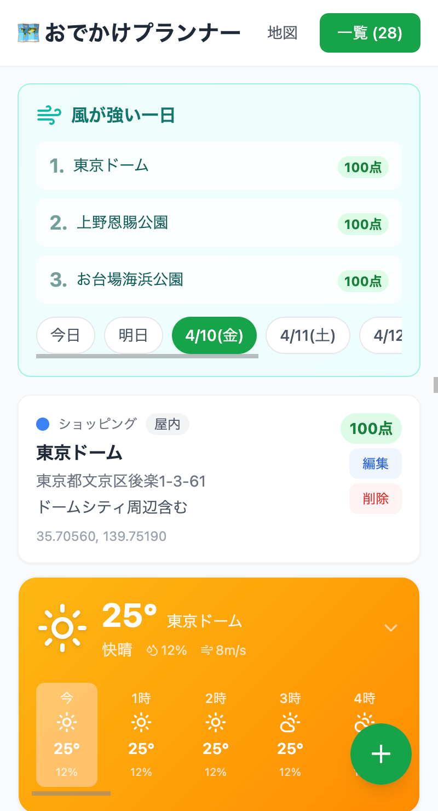
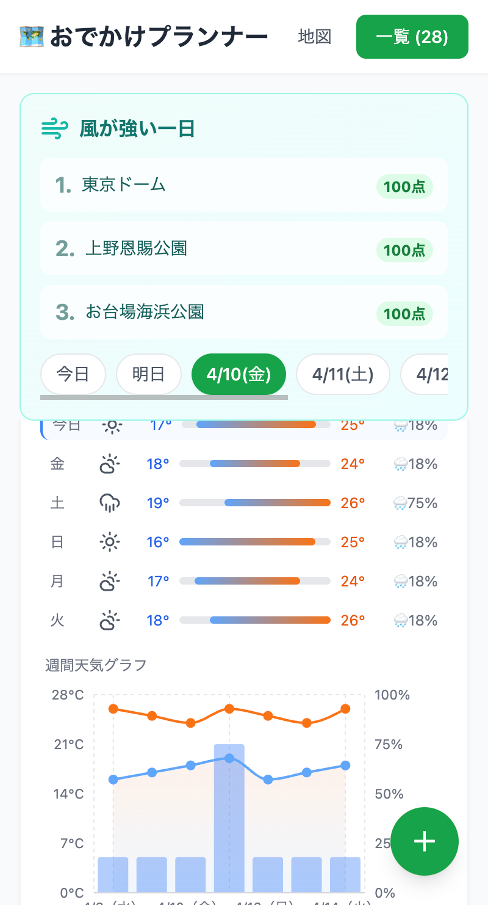
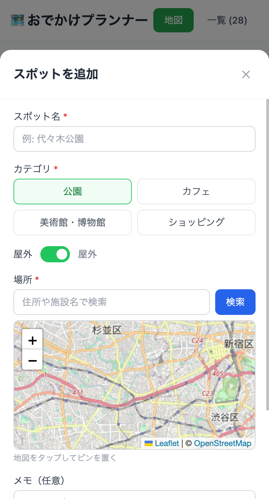

# Practical Example: Building an Outing Planner

This document is a practical guide for getting your project up and running from scratch using the [/kickstart skill](kickstart-skill.md) and advancing development through Phase B.

By actually following these steps, you'll experience the entire guide workflow firsthand.

### What You'll Build

> The following screenshots are from an app actually built by following this walkthrough. Your results will vary depending on how you write your prompts and decisions you make, so treat these as a reference image of what's possible.

<table>
  <tr>
    <td align="center"><br><b>Recommendations + Map</b></td>
    <td align="center"><br><b>Spot Details + Weather</b></td>
    <td align="center"><br><b>Weekly Weather Graph</b></td>
    <td align="center"><br><b>Spot Registration</b></td>
  </tr>
</table>

> **Note**: This project uses the following external services. Both are free and require no API key, but please review each service's usage policy before running.
> - **Open-Meteo API** (weather data): [Terms of service](https://open-meteo.com/en/terms)
> - **OpenStreetMap** (map tiles): [Tile usage policy](https://operations.osmfoundation.org/policies/tiles/) (attribution `© OpenStreetMap contributors` is required; Leaflet displays this by default)

---

## Prerequisites

1. Claude Code is installed ([installation instructions](setup.md))
2. The `/kickstart` skill is installed ([setup instructions](kickstart-skill.md#setup))

No special data preparation is needed. Location data is CRUD that you'll register within the app itself, so you can get started right away.

---

## Phase A: Project Setup

### Step 0: Create Project → Run /kickstart

```bash
mkdir outing-planner && cd outing-planner
claude
```

Once Claude Code starts:

```
> /kickstart
```

A0 (automatic initialization) runs, creating `.gitignore` and `docs/` (`decisions/`, `_wip/`, and a `README.md` describing the documentation policy).

---

### Step 1 (A1): Requirements — Tell Claude

Claude will ask "What would you like to build?" Answer with something like:

```
I want to build a web app that lets you register your favorite outing spots
and combines them with weather forecasts to help you decide where to go today.
```

Claude will dive deeper, so communicate these key points:

| Question | Reference Answer |
|----------|----------|
| Who's the target? | Individuals to families |
| Principles to keep? | Visual appeal and ease of use. Never store location data outside the device |
| What we won't build? | Reservations/payments, route navigation (for the MVP) |
| Vision? | An app where you register spots in advance, then get today's recommendations based on the weather |
| MVP features? | See below |

**Example MVP features (narrow down to about 4):**

1. Register, edit, and delete favorite outing spots (CRUD) + display on map (Leaflet + OpenStreetMap)
2. Fetch and display weather forecasts for current location and registered spots via weather API
3. Display weekly weather as graphs (temperature trends and precipitation probability)
4. Suggest "today's recommended spots" based on weather and category

**Example future features:**
- Photo uploads for spots
- Sharing with family and friends
- Visit history logging and reflection

> **Key Point**: Keep the MVP to "the minimum that would make it fun." If there's too much, Claude will ask "Which can we defer?"

Once Claude creates `docs/requirements.md`, review it and say "OK."

---

### Step 2 (A2): Create /consult Skill

Claude automatically creates the `/consult` skill. Verify that the service's vision, principles to keep, and what we won't build are reflected.

No special instructions needed — Claude will proceed. Review and say "OK."

---

### Step 3 (A3): Requirement Brainstorming

Claude uses `/consult` to dive deeper into requirements. Discussion progresses from perspectives like:

- **User Flow**: Register spot → check weather → see recommendations
- **Error Cases**: What if the weather API is down? What if location isn't available?
- **Data Volume**: How does performance scale as more spots are added?
- **Authentication**: Not needed (local tool, no login required)

```
Thinking hints:
- "How should we categorize spots? (parks, cafes, museums, shopping...)"
- "What's the weather threshold? What precipitation % triggers indoor recommendations?"
- "Should the recommendation logic be simple? (Sunny → outdoor, rainy → indoor)"
```

Once brainstorming is complete, `docs/requirements.md` is updated (decisions with rejected options are also recorded in `docs/decisions/`). Review and say "OK."

> **Tip**: Sleeping on this overnight helps — next day you'll realize "Oh, we need that too."

---

### Step 4 (A4): Base Spec Decision ← Most Important

> **Switch to Opus here.** Claude will prompt you.
> ```
> /model opus
> ```

Claude will present technology options in a comparison table. Here's guidance for decision-making.

#### Decision-Making Points

Since this project is "a local web app + external API integration":

| Perspective | Recommended Direction | Reason |
|------------|------------------|--------|
| Frontend | React or Vue + charting library | Weather graphs and card displays are central; charting library richness matters |
| Backend | Lightweight framework | Focused on CRUD and API relay; no heavy framework needed |
| DB | SQLite | Necessary for persisting location data; lightweight is sufficient |
| External API | Open-Meteo (no API key) | Free, no authentication, and permissive limits for non-commercial use |
| Map | Leaflet + OpenStreetMap | No API key needed, free, lightweight. Perfect for displaying spot locations |
| Infrastructure | Local execution | MVP runs on localhost; set up for future deployment |

```
You can tell Claude:
"I want visually appealing weather cards and graphs.
Use SQLite for the DB and Open-Meteo for the weather API.
Choose the tech stack and show me a comparison table."
```

Besides the tech stack, this step also settles the branch workflow (e.g., work on `develop`, keep `main` always working) the type-check and test commands, and **where tasks live**. For a solo project, `docs/tasks.md` is recommended; for a team, GitHub Issues. This walkthrough uses `docs/tasks.md`.

Claude creates `docs/spec.md` (only the skeleton that rarely changes) and records each decision with rejected options as one file in `docs/decisions/`.

Review and say "OK."

---

### Step 4.5 (A4.5): Implementation Policy

Still on Opus, decide **which way to lean when in doubt** and summarize it in `docs/implementation-policy.md`. Claude presents the perspectives one at a time; decide only those that apply to this project.

```
Reference:
- External API calls: If Open-Meteo is down, show stale cached data. If there is none, show "Couldn't fetch the weather" and keep showing the spot list
- Logs: Never log spot latitude/longitude. Only IDs and counts
- Tests: Replace Open-Meteo with a fake. Never call the real one
```

---

### Step 5 (A5): Create CLAUDE.md

> **Switch back to Sonnet.**
> ```
> /model sonnet
> ```

Claude creates the project configuration file `CLAUDE.md`.

Verification points:
- It contains only a table of contents for docs/ and the "promises" (procedures go in agent definitions)
- Common commands (type check, tests, dev server) match the A4 decision
- Stays under 50 lines

Say "OK" and move forward.

---

### Step 6 (A6): Create Sub-agents

Claude creates an agent team matching the base spec.

For this project, you'll likely get a team like:

| Agent | Role |
|-------|------|
| advisor | Advisor (read-only). Decisions that touch policy, and milestone reviews of the whole |
| developer | Full-stack implementation (CRUD API, weather API integration, UI, charts). Calls qa-engineer → code-reviewer before committing |
| qa-engineer | Testing. Doesn't trust developer's "it passed"; runs the tests itself |
| code-reviewer | Lightweight per-commit review (staged diff only) |

Verify that each agent's description includes **specific technology stack names** (not just "developer" but "build full-stack with backend framework, SQLite, React + Recharts").

---

### Step 7 (A7): Skills, Commit Guard, and Initial Commit

Claude creates and executes:

1. `/ask-advisor` skill (consulting the advisor, milestone reviews) and `/commit` skill
2. `/task` skill (view, add, and close tasks) and `/overnight` skill (advance tasks while you sleep)
3. First tasks (turns the 4 MVP features into one task per feature and writes them to `docs/tasks.md`. Claude shows you the list; check it and say "OK")
4. Commit guard (blocks commits of `.env` files and API keys with two layers: a git hook and a Claude Code hook. You are always asked for confirmation before a push or creating a Pull Request)
5. Hooks configuration (formatter, optional)
6. Test strategy confirmation
7. Initial commit

When asked about test strategy:
```
Reference:
- Unit tests: CRUD operations, weather API integration mocking, recommendation logic
- E2E: Can defer for MVP
```

> A8 (runbook skills for irreversible operations) is optional. This project runs locally, so "not now" is fine.

Once initial commit completes, **Phase B transition guide** appears.

---

## Phase B: Development Cycle

Once Phase A is complete, implement features one by one using this cycle:

### Cycle Flow

```
0. /task                  → Pick the next task
1. /consult               → Brainstorm feature requirements
2. Plan Mode              → Make implementation plan (enter with /plan)
2.5. Persistence          → Save detailed design to docs/_wip/
3. Implement with @agent-developer → implement → qa-engineer → code-reviewer → commit
4. Cleanup                → Move docs/_wip/ content into docs/ or delete it, /task done
(Once 2–3 features are done, /ask-advisor milestone review. For findings marked "→task", use /task add)
```

> Type `/overnight` before bed and Claude advances the tasks you've handed off until morning. See [Phase B: Advance While You Sleep](workflow-daily.md#advance-while-you-sleep--overnight) for details.

### Recommended Implementation Order

Implementing the 4 MVP features in this order shows progress at each stage:

#### First Cycle: Spot CRUD

First, pick the next task.

```
> /task
(Claude lists the "next up" tasks and recommends T-001 Spot CRUD)
> Go with T-001
```

```
> /consult
> As the first feature, I want to register, edit, and delete outing spots.
  Each spot has a name, address (or latitude/longitude), and category
  (park, cafe, museum, etc.). Also display spots on a map using Leaflet and OpenStreetMap.
  Save the detailed design to docs/_wip/feature-spot-crud.md.
```

Once the detailed design is saved, `/clear` then implement:

```
> /clear
> @agent-developer Following the detailed design in docs/_wip/feature-spot-crud.md, implement the full-stack feature.
  Implement the CRUD API with SQLite persistence, and build the spot list display,
  registration form, edit, and delete UI. Use category-specific icons to make it visually appealing.
  Also implement a map component using Leaflet and OpenStreetMap to display all registered spots.
  Write unit tests too.
```

When implementation is done, developer asks qa-engineer to test and code-reviewer to review the staged diff, then commits. Check that the report includes the tail of the type-check and test output. After the commit, clean up `docs/_wip/feature-spot-crud.md` (move requirements and decision rationale into docs/, delete the rest). Since developer has moved the task to "Done", run `/task done T-001` to check that the completion criteria are met and close it.

From the second cycle on, start the same way by picking with `/task`, and close with `/task done`.

What you're building:
- Spot CRUD API with SQLite persistence
- Spot registration form (name, address, category)
- Spot list (card display)
- Edit and delete functionality
- Map display with spots (Leaflet + OpenStreetMap)
- Unit tests

```
Completion image: Register spot → displays as a card in the list and on the map
```

#### Second Cycle: Weather Display

```
> /consult
> I want to display weather forecasts for registered spots.
  Use the Open-Meteo API to fetch weather for spot latitude/longitude.
  Show weather icons, temperature, and precipitation probability in an easy-to-read card.
  Save the detailed design to docs/_wip/feature-weather.md.
```

Once the detailed design is saved, `/clear` then implement:

```
> /clear
> @agent-developer Following the detailed design in docs/_wip/feature-weather.md, implement the full-stack feature.
  Implement the module that fetches weather forecasts from Open-Meteo API with caching (about 30 minutes).
  Build the weather forecast card component displaying weather icons, temperature, and precipitation probability.
  Include unit tests with mocked API responses.
```

What you're building:
- Open-Meteo API integration module
- API response caching
- Weather forecast card (weather icons, temperature, precipitation)
- Unit tests

```
Completion image: Select a spot → weather forecast card displays
```

**Recommended: Ask the advisor for a milestone review here:**

```
> /ask-advisor milestone review. The previous milestone is the initial commit.
  Also tell me about issues that might come up adding the remaining 2 features.
```

The advisor looks at the diff since the previous milestone and returns "Must fix (most severe first)", "To think about before the next milestone", and "What improved". It also points out forgotten cleanup in `docs/_wip/` and decisions not yet recorded in `docs/decisions/`.

#### Third Cycle: Weekly Weather Graph

```
> /consult
> I want to visualize a spot's weekly weather as a graph.
  Display temperature trends as a line graph and precipitation probability as a bar chart.
  Save the detailed design to docs/_wip/feature-weather-chart.md.
```

Once the detailed design is saved, `/clear` then implement:

```
> /clear
> @agent-developer Following the detailed design in docs/_wip/feature-weather-chart.md, implement it.
  Build the weekly weather graph components using a chart library to make visually appealing graphs
  for temperature trends and precipitation probability.
```

#### Fourth Cycle: Recommended Spots

```
> /consult
> I want to add a feature that suggests "today's recommended spots" based on weather.
  Recommend outdoor spots like parks if it's sunny, and indoor spots like museums and cafes if it's rainy.
  Save the detailed design to docs/_wip/feature-recommend.md.
```

Once the detailed design is saved, `/clear` then implement:

```
> /clear
> @agent-developer Following the detailed design in docs/_wip/feature-recommend.md, implement the full-stack feature.
  Implement the recommendation logic with tests, and build the "today's recommended" spot card UI.
  Make the card background color and icons change based on the weather.
```

**Wrapping up after MVP completion:**

```
> @agent-qa-engineer Test all features end-to-end. If any areas lack coverage, add tests.
> /ask-advisor milestone review. The previous milestone was <the commit last reviewed>
> /task
(Clear out the tasks left in "Done", and add the review's "→task" findings with /task add)
```


---

### Using Sub-agents

In Phase B's development cycle, utilize the agents created in Phase A's Step 6.

#### How to Call Agents

When you type `@` in Claude Code's prompt, agents appear as suggestions alongside files. If you select an agent, it is inserted as `@"developer (agent)"`; then write your instructions and send. Typing `@agent-developer` by hand works the same way:

```
> @agent-developer (write your instructions here)
```

> If you specify a file path such as `@.claude/agents/developer.md`, you are passing a **file**, not the agent. To call an agent, select it from the suggestions or write `@agent-<name>`.

> Asking by name, such as "implement this with the developer agent", will usually delegate to it too. Specifying it with `@` guarantees that agent is used.

#### Agent Usage Map

```
/consult (requirement brainstorming)
  ↓
Plan Mode (implementation planning)
  ↓ If unsure about anything touching policy, consult /ask-advisor
  ↓
Persistence (save detailed design to docs/_wip/)
  ↓
Implementation ← @agent-developer implements backend and frontend
  ↓   (developer calls these itself)
  ├─ Testing ← qa-engineer writes tests and runs them itself
  ├─ Review ← code-reviewer looks at the staged diff
  ↓
Commit (done by developer; the commit guard blocks secrets)
  ↓
Cleanup (move docs/_wip/ content into docs/ or delete it)
  ↓
Once 2–3 features are done, /ask-advisor milestone review
```

#### Information Handoff Between Agents

In the normal workflow, `developer` implements both backend and frontend in one session, and when it calls qa-engineer and code-reviewer it passes "what changed, the expected behavior, and the related files." You don't need to hand information between agents yourself.

Sub-agents can reference current context (conversation flow). When working with a single developer agent and other agents, this pattern works well:

**Reset session, then call (using /clear)**

```
/consult brainstorms feature → saves detailed design to docs/_wip/
  ↓
/clear to reset context
  ↓
@agent-developer is called
  → Tell it to "read docs/_wip/xxx.md and implement" — share info via files
  ↓
After implementation, /clear again if needed
  ↓
@agent-qa-engineer is called
  → References detailed design and implementation files
```

- Documentation remains for future reference
- Conserves context
- Info must be saved to file or it disappears

**This pattern is recommended** because:

1. **Reusability**: Implementation results remain in files, referenced from other sessions/agents
2. **Context Savings**: Context margin is crucial for long feature development
3. **Best Practice**: "Always save deliverables" is fundamental to project management where knowledge persists even when sessions disappear
4. **Clear handoff**: Developer agent reads the detailed design and implements based on documented requirements

#### Example Agent Calls

**developer — Spot CRUD (full-stack)**

```
> @agent-developer Following the detailed design in docs/_wip/feature-spot-crud.md,
  implement the full-stack CRUD feature for outing spots.
  Build the API with SQLite persistence and the UI components.
  Write unit tests for both backend and frontend.
```

**developer — Weather display (full-stack)**

```
> @agent-developer Following the detailed design in docs/_wip/feature-weather.md,
  implement the full-stack weather feature.
  Build the module that fetches forecasts from Open-Meteo API with caching (about 30 minutes),
  and implement the weather forecast card component.
  Include unit tests with mocked API responses.
```

**advisor — Consultation**

```
> /ask-advisor I can't decide whether to cache the weather API on the server or in the browser.
  Server: shareable across spots / Browser: keeps the backend simple.
  The related file is docs/_wip/feature-weather.md.
```

> The advisor returns "conclusion, reasons, rejected options, when to revisit, and a draft record." Keep the draft record in `docs/decisions/`. Once 2-3 features are done, also ask for a "milestone review" to find design issues early.

**qa-engineer — Testing**

```
> @agent-qa-engineer Enhance unit tests for spot CRUD and recommendation logic.
  Cover these edge cases:
  - No spots registered
  - Weather API returns an error
  - Spot category is unset
```

#### Agent Usage Tips

| Tip | Explanation |
|------|-----------|
| **Pass detailed designs** | When you say "follow the detailed design in docs/_wip/xxx.md", agent reads the design then implements |
| **Save investigation results** | Have research results saved to `docs/_wip/<topic>.md`. Without saving, next agent can't reference. Anything used to make a decision is kept under "Evidence" in `docs/decisions/` |
| **One request, one task** | developer can build both backend and frontend, but give each request only one task (one feature). The completion criteria are clear and review is easier |
| **Two levels of review** | Per commit: code-reviewer (light). Per feature set: `/ask-advisor` milestone review (heavy) |
| **Verify "it passed" with output** | Check that developer's report includes the tail of the type-check and test output. qa-engineer also runs them itself |

---

## What to Keep in Mind Each Cycle

### After /consult

- After Plan Mode planning, **always save a detailed design to `docs/_wip/`**
- Be explicit: "Save the detailed design to docs/_wip/feature-weather.md"

### During Implementation

- Say "write tests too"
- Once it works, validate with "run tests and show results"

### Committing

When you asked developer to implement, developer commits after going through qa-engineer and code-reviewer. When committing changes you fixed yourself:

```
> /commit
```

That's it — it creates rule-following commits. If the commit guard blocks it, unstage that file (don't skip the hook).

### After Committing

- Clean up the detailed design in `docs/_wip/`. Move anything that counts as requirements or decision rationale into docs/, and delete the rest (the source code holds it)

### Before Next Cycle

```
> /clear
> /task
```

Reset context, then pick the next task with `/task`. Add any "worth doing" items that came up along the way (such as the "task candidates" in developer's report) with `/task add` here.

---

## When You Get Stuck

| Situation | Solution |
|-----------|----------|
| Claude's implementation doesn't work | "Run tests" to verify. Paste errors as-is for fix instructions |
| Still broken after 2 fixes | `/clear` then re-instruct from scratch including what you learned |
| Context is full | `/compact` to compress, or `/clear` to reset |
| Want to undo | `Esc + Esc` to rewind to checkpoint |
| Unsure about design | Consult `/ask-advisor` (or switch with `/model opus` to discuss) |
| Weather API is erroring | Check Open-Meteo status page. If you have cached data, the app works with older data |

---

## Advanced: Parallel Development with Agent Teams

> **This is an experimental feature.** We recommend completing the MVP with the sub-agent method described above first.

### What This Is, in a Sentence

**One PC, one terminal — AI forms a team, communicates with each other, and develops in parallel.**

The same teamwork humans do happens on your single PC.

### Contrast with Human Teamwork

```
Human teamwork                    AI agent team
─────────────────────────         ─────────────────────────
PM assigns tasks via Slack        → Leader assigns via task list
Backend developer implements      → backend session implements
Frontend developer implements in parallel → frontend session implements in parallel
Code review when done              → reviewer reviews and points out issues
QA tests                           → qa writes and runs tests
Slack: "Ready to merge?"           → Message: "Implemented, review please"
Everyone works on same git repo    → Everyone works on same git repo
```

The difference: **this all happens in one terminal in minutes to tens of minutes.**

### Setup

Add to `~/.claude/settings.json` (if not already set):

```json
{
  "env": {
    "CLAUDE_CODE_EXPERIMENTAL_AGENT_TEAMS": "1"
  }
}
```

### Demo: Second Cycle Parallel Development with Team

Example of doing the second cycle (weather display) with the team, starting from where the first cycle (spot CRUD) is done.

#### 1. Instruct the Leader

```
> I want to parallelize the second cycle's "weather display" with the team.
  Based on the detailed design in docs/_wip/feature-weather.md,
  form these teams and proceed in parallel:

  - backend: Open-Meteo API integration + caching
  - frontend: Weather forecast card UI
  - qa: Test creation
```

#### 2. Leader Forms Team and Starts

The leader auto-forms the team and assigns tasks. The following happens **simultaneously before your eyes:**

```
┌─────────────────────────────────────────────────────────┐
│ Leader                                                   │
│ > Forming team. Creating task list...                   │
│ > Launched backend, frontend, qa                        │
└─────────────────────────────────────────────────────────┘
     │
     ├── backend launches
     │   "Implementing Open-Meteo API client...
     │    Creating src/services/weather-api.ts"
     │
     ├── frontend launches
     │   "Implementing weather forecast card...
     │    Creating src/components/WeatherCard.tsx"
     │
     └── qa launches
         "Considering test strategy...
          Inventorying test cases"
```

#### 3. Team Members Communicate

```
backend → Leader:
  "API integration and caching complete.
   Weather data type: WeatherForecast { ... }"

Leader → frontend:
  "Backend API is ready.
   Refer to the WeatherForecast type and finish the UI"

frontend → Leader:
  "Weather card implementation complete.
   Weather icons and responsive design included"

Leader → qa:
  "Backend and frontend implementation complete. Write tests."

qa → Leader:
  "All tests created. 12/12 passing.
   API error fallback covered"
```

#### 4. Leader Integrates and Commits

Once all members complete, leader integrates and commits:

```
Leader:
  "All members complete.
   - API integration + caching ✓
   - Weather card UI ✓
   - Tests 12/12 pass ✓
   Committing now."
```

#### 5. Terminal View

Use `Shift + ↓` to switch between team members and see **in real-time what each is doing**.

```
┌─ Leader ──────────────────────────────────────────┐
│ Task progress:                                    │
│ ✓ backend: API integration complete              │
│ ● frontend: UI implementation... (80%)            │
│ ✓ qa: test creation complete                     │
│                                                   │
│ [Shift+↓ to switch to other members]              │
└───────────────────────────────────────────────────┘
```

### More Boldly: Parallelize All 4 MVP Features

Once comfortable, you can let the team handle the entire MVP:

```
> Based on the 4 detailed designs in docs/_wip/,
  parallelize development of all MVP features.

  Team composition:
  - backend: Spot CRUD + weather API integration + recommendation logic
  - frontend-spots: Spot management UI
  - frontend-weather: Weather card + weekly graph
  - frontend-recommend: Recommended spots UI
  - qa: tests for each feature (sequential as members complete)

  Once backend finishes, share with frontend members.
  Once all done, qa tests everything, then commit together.
```

**What takes a human team days happens in tens of minutes before your eyes** — this is the impact of agent teams.

### Cautions

| Item | Details |
|------|---------|
| **Token consumption** | Uses context per member. 3-person team ≈ 3 session costs |
| **Experimental** | Unexpected errors or member stalling can happen |
| **Detailed designs are essential** | Team members read the detailed designs in `docs/_wip/`. Ambiguous designs → scattered implementations |
| **Conflicts** | Multiple members touching same file → git conflicts. Keep responsibilities clear |
| **Start small** | Don't jump to all features. Try 2-3 people on 1 feature first |
| **Runs outside the harness flow** | Members work in parallel in the same working tree, and the leader commits everything together. The developer flow of "go through qa-engineer and code-reviewer before committing" and "split working trees with `git worktree` when running in parallel" does not apply. The commit guard still works, but ask the leader to confirm tests and review |

### Choosing Between Sub-agent and Team Methods

```
Sub-agent method (called with @agent-xxx)
  → "Pair programming" style: instruct one by one
  → Stable, low cost
  → Start here

Agent teams
  → "Team development" style: multiple people at once
  → Parallel and fast, but costly and experimental stage
  → Level up after getting comfortable with sub-agents
```

---

## Summary

```
Phase A (/kickstart) builds foundation              → About 1-2 sessions
Phase B implements features one by one              → 1 feature = 1 cycle
  ├─ Sub-agent method (basic)                       → Instruct one by one
  └─ Agent team method (advanced)                   → AI team develops in parallel
4 features complete → MVP done                      → Days to ~1 week
```

The key is "don't try to build everything at once." Verify working features after each cycle.

Agent teams give a glimpse of the future of development. Master the sub-agent basics first, then explore the world of team development.
